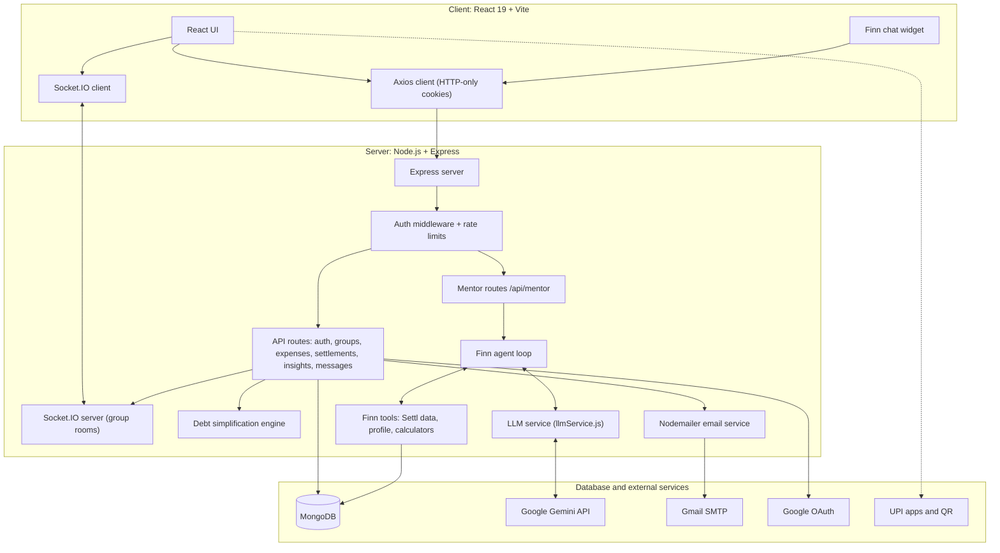
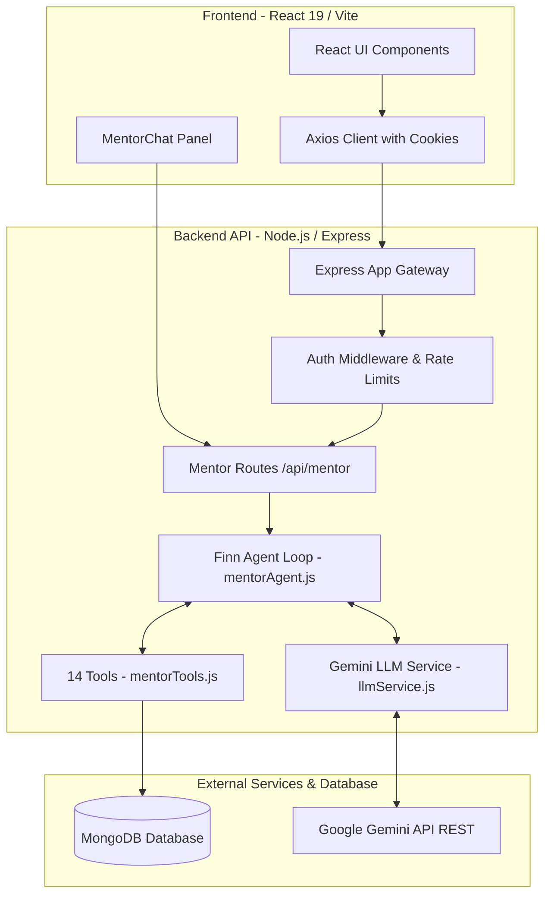

# Settl. 💸

Settl is a modern full-stack bill-sharing and personal finance platform designed for flatmates, friends, and travel groups. It combines group expense splitting (equal, exact rupee, and percentage), greedy debt simplification to minimize total transactions, peer-to-peer Indian UPI settlements via dynamic QR codes and mobile deep links, an automated behavioral Trust Score (0–100), and Finn — an AI financial mentor powered by Google Gemini that provides user-scoped educational guidance, deterministic calculators, and personal budget coaching.

---

## Features

- **Group Expense Splitting**: Add shared expenses with equal, exact amount, or percentage splits with server-side validation.
- **Greedy Debt Simplification**: Computes net balances per member and simplifies complex webs of IOUs to the minimum number of direct transactions.
- **UPI Payments & Dynamic QR Codes**: Generate instant UPI deep links (`upi://pay`) on mobile and dynamic QR codes (`qrcode.react`) on desktop with two-step UPI ID verification guards.
- **Verified Settlement Lifecycle**: Payer initiates a settlement request, receiver confirms or rejects payment receipt, with payer cancellation, duplicate request blocking, and auto-expiry of stale requests.
- **Behavioral Trust Score (0–100)**: Transparent score evaluated across Repayment Reliability (50%), Upfront Contribution (35%), Spending Consistency (15%), and dispute fraud deductions.
- **Finn (AI Financial Mentor)**: Conversational agent using Google Gemini with 14 user-scoped tools, conversational history, and deterministic financial calculators.
- **Consent-Gated Financial Profile**: Form-driven profile for income, savings targets, and financial goals; accessed strictly when consent is enabled, and deletable at any time.
- **Real-Time Synchronization**: Instant WebSocket room broadcasts for added expenses, deleted expenses, settlement status updates, and group chat messages.
- **Group Chat & Activity Feed**: Paged activity audit log recording member joins, expense creations, settlement requests, disputes, and chat messaging.

---

## High-Level System Architecture



1. **Client Layer (React 19 / Vite)**: Renders the user interface and Finn chat panel, communicating via Axios with credentials (HTTP-only cookies) and receiving live room events through Socket.IO.
2. **Server Layer (Node.js / Express)**: Enforces authentication and rate limits, coordinates route controllers, runs greedy debt simplification, dispatches emails with Nodemailer, and runs the Finn agent loop with its tool registry.
3. **Database & External Services**: Persists operational state in MongoDB, accesses Google Gemini via backend REST calls, connects to Gmail SMTP for verification emails, verifies Google OAuth tokens, and connects users to UPI payment apps.

---

## How Debt Simplification Works

The debt simplification algorithm resolves complex webs of group IOUs into the minimum number of direct peer-to-peer transactions. First, it calculates each member's net balance by subtracting their share of group expenses from the total payments they made upfront. Members are then partitioned into creditors (net positive) and debtors (net negative) and sorted in descending order of absolute amounts. A greedy matching loop repeatedly settles the maximum possible balance between the largest debtor and largest creditor until all balances reach zero.

---

## WebSocket Events

Settl uses Socket.IO to keep group members in sync in real time. Clients join rooms partitioned by `groupId` upon opening a group view:

| Event Name | Direction | Payload | Handler / Effect |
| :--- | :--- | :--- | :--- |
| `join_group` | Client → Server | `groupId` | Joins the specified group socket room after membership verification |
| `leave_group` | Client → Server | `groupId` | Leaves the group socket room |
| `expense_added` | Server → Client | Populated `Expense` | Appends expense to feed and recalculates group balances |
| `expense_deleted` | Server → Client | `{ expenseId }` | Removes expense from feed and recalculates balances |
| `settlement_requested` | Server → Client | Populated `Settlement` | Notifies receiver of pending payment request |
| `settlement_done` | Server → Client | Populated `Settlement` | Notifies payer that receiver confirmed payment; clears debt |
| `settlement_undone` | Server → Client | `{ fromId, toId }` | Reverts UI when a settlement is cancelled by payer or rejected by receiver |
| `message_created` | Server → Client | Populated `Message` | Appends new message to the group chat window |

*Note: Settlement records follow the lifecycle: `pending` → `confirmed`, with `cancelled` (payer-cancelled) and `expired` (auto-expired after 7 days) terminal states.*

---

## Database Schemas & Models

| Model | Collection / Purpose | Key Fields |
| :--- | :--- | :--- |
| `User` | User accounts & credentials | `name`, `email`, `password`, `upiId`, `isEmailVerified`, `emailVerificationToken`, `emailVerificationExpires` |
| `Group` | Shared expense groups | `name`, `description`, `members` (`user`, `role`), `createdBy`, `currency` |
| `Expense` | Recorded group expenses | `description`, `amount`, `paidBy`, `group`, `splits` (`user`, `amount`, `paid`), `splitType`, `category` |
| `Settlement` | P2P settlement transactions | `group`, `from`, `to`, `amount`, `status` (`pending`, `confirmed`, `cancelled`, `expired`) |
| `ActivityLog` | Audit trail for group events | `group`, `actor`, `type`, `meta` |
| `Message` | Real-time group chat messages | `group`, `sender`, `content` |
| `ScoreHistory` | Historical Trust Score records | `user`, `score`, `breakdown`, `calculatedAt` |
| `MentorConversation` | Finn chat history | `user`, `messages` (`role`, `content`, `toolsUsed`, `timestamp`), `lastActiveAt` |
| `UserFinancialProfile` | Consent-gated financial profile | `user`, `status`, `monthlyIncome`, `monthlySavingsTarget`, `goals` (`name`, `targetAmount`, `deadline`, `savedSoFar`), `riskComfort`, `language`, `consentToUseForMentor` |

---

## Finn (AI Financial Mentor)

Finn is Settl's personal AI financial mentor, powered by Google Gemini through [backend/src/services/llmService.js](backend/src/services/llmService.js) and an autonomous tool-calling loop in [backend/src/services/mentorAgent.js](backend/src/services/mentorAgent.js). It provides educational financial guidance, deterministic calculations, and spending insights using 14 user-scoped and consent-gated tools. Finn provides educational guidance only — **not** licensed financial advice — and **never** recommends specific stocks, mutual funds, or commercial products.

The backend exposes both standard JSON (`POST /api/mentor/chat`) and Server-Sent Events streaming (`POST /api/mentor/chat/stream`). The frontend client currently interacts via `POST /api/mentor/chat` using `sendMentorMessage()` in [frontend/src/api/mentor.js](frontend/src/api/mentor.js).

### Finn Architecture



### Tool-Calling Loop
1. **User Query & History**: The user's query and the last 10 conversation turns from `MentorConversation` are packaged into Gemini's payload alongside a personalized system prompt with user first name and language preference (`en` or `hinglish`).
2. **Model Evaluation & Tool Execution**: Gemini runs with temperature `0.2` and declared tool schemas. When the model requests tool calls, duplicate calls are deduplicated via signature caching, handlers execute with server-enforced `userId` scoping, and results are returned to Gemini as `functionResponse`.
3. **Response & Persistence**: Gemini synthesizes the final educational guidance, which is saved to `MentorConversation` alongside tool execution metadata.

<details>
<summary><strong>Complete Tool Registry (14 Tools)</strong> — click to expand</summary>

All 14 tools are implemented in [backend/src/services/mentorTools.js](backend/src/services/mentorTools.js). Parameter schemas, defaults, and clamping limits match the code exactly:

| Category | Tool Name | Parameters | Description |
| :--- | :--- | :--- | :--- |
| **Settl Data** | `getUserFinancialSummary` | None | Comprehensive overview of groups, upfront spend, total owed, total owed to user, net balance, and pending settlements. |
| **Settl Data** | `getGroupBalances` | None | Detailed balances across all user groups with member lists, simplified debts, and pending requests. |
| **Settl Data** | `getPendingSettlements` | None | Pending settlements requiring confirmation by the user or awaiting confirmation from others. |
| **Settl Data** | `getExpenseBreakdown` | `months` (optional): 1 to 12, default 3 | Categorical spending breakdown (food, rent, groceries, shopping, etc.) with amounts and percentage shares. |
| **Settl Data** | `getSpendingTrend` | `months` (optional): 1 to 12, default 6 | Monthly spending trends (up to 12 months) showing group share spending, upfront payments, and expense counts. |
| **Settl Data** | `getTrustScoreDetails` | None | Trust Score (0–100), score band, promptness hours, on-time rate, dispute count, and 4 dimension sub-scores. |
| **Settl Data** | `getTrustScoreHistory` | None | Historical Trust Score snapshots from `ScoreHistory` (up to 20 entries) with score and timestamp. |
| **Settl Data** | `getSettlementHistory` | `limit` (optional): 1 to 50, default 10 | Recent settlement history showing group, amount, status, direction (paid/received), counterpart, and date. |
| **Profile** | `getUserProfile` | None | User financial profile (status, income, savings target, risk comfort, language, active goals); requires consent. |
| **Profile** | `getGoalProgress` | `goalName` (optional): asks which goal if omitted and multiple exist | Goal progress metrics, remaining amount, months left, required monthly savings, and capacity gap; requires consent. |
| **Calculator** | `calculateSavingsTimeline` | `targetAmount` (required): > 0; `monthlyAmount` (required): > 0; `savedSoFar` (optional): >= 0, default 0 | Computes months and years needed to save target amount given monthly savings contribution. |
| **Calculator** | `calculateSIP` | `monthlyInvestment` (required): 1 to 10 Cr; `rateOfReturnAnnual` (optional): 0 to 30%, default 12%; `timePeriodYears` (optional): 1 to 40, default 5 | Computes SIP future returns, total invested, and estimated returns using monthly compounding in JS (marks assumed return rate when omitted). |
| **Calculator** | `calculateBudgetSplit` | `monthlyIncome` (optional): falls back to profile income | Computes rule-of-thumb monthly budget allocation (50% Needs, 30% Wants, 20% Savings) in JS. |
| **Calculator** | `calculateEmergencyFund` | `customMonthlyExpenses` (optional): falls back to profile or group data; `monthsCount` (optional): 1 to 24, default 6 (3 for students/interns) | Computes recommended emergency reserve pool based on monthly expense baseline and target coverage. |

</details>

<details>
<summary><strong>Prompt-Rule Themes & Guardrails</strong> — click to expand</summary>

Finn's behavioral discipline is governed by strict rules implemented in [`SYSTEM_PROMPT` in backend/src/services/mentorAgent.js](backend/src/services/mentorAgent.js):

- **Debt Prioritization**: Before answering decision queries (SIPs, purchases, saving targets), Finn inspects net balances and Trust Score. If balance is negative or score is "At Risk" (< 50), Finn insists on clearing debts first and never gives approval.
- **Affordability Boundaries**: Explicitly states Settl cannot see external bank accounts or personal savings. Asks at most one clarifying question; never gives blanket yes/no approval.
- **Data Limits & No LLM Arithmetic**: Only references shared group spending. Never computes percentages in text; all figures and percentages must come directly from tool outputs with explicit unit metadata (`percentageUnit: "percent"`).
- **Objective Tone & Terminology**: Maintains a neutral, empowering tone without flattery ("impressive", "great job"). Uses "group spending" or "your share of group expenses", never "total personal spending".
- **Untrusted User Data Handling**: All user-provided strings (group names, counterpart names, goal names) are wrapped in `untrustedText` and stripped of prompt injection patterns via `sanitizePromptText()`.
- **Target vs. Actual Savings Phrasing**: States "your plan fits your savings target"; never claims "you are saving" or "you are on track" as Settl cannot verify external bank balances.
- **Tool Boundaries & Single Question**: Only offers actions supported by tools (explain, calculate, fetch). Never drafts messages or initiates transfers. Ends replies with at most one clarifying question.

</details>

<details>
<summary><strong>How to Add a Tool</strong> — click to expand</summary>

To register a new tool with Finn:

1. Add a tool declaration to `MENTOR_TOOLS_REGISTRY` in [backend/src/services/mentorTools.js](backend/src/services/mentorTools.js):
   ```javascript
   {
     name: "calculateTaxSavingsEstimate",
     description: "Calculate illustrative Section 80C tax deduction estimate deterministically in JS.",
     parameters: {
       type: "object",
       properties: {
         invested80C: {
           type: "number",
           description: "Total investments under Section 80C in INR (clamped >= 0)",
         },
       },
       required: ["invested80C"],
     },
     handler: async (userId, args = {}) => {
       const invested = Math.max(0, Number(args.invested80C || 0));
       const maxDeduction = 150000;
       const eligibleDeduction = Math.min(invested, maxDeduction);
       return {
         currency: "INR",
         investedAmount: eligibleDeduction,
         maxAllowed: maxDeduction,
         remainingCap: Math.max(0, maxDeduction - eligibleDeduction),
         formulaUsed: "Section 80C statutory limit in JS",
       };
     },
   }
   ```
   *(The schema is exported automatically to Gemini via `MENTOR_TOOLS_SCHEMA`, and execution is handled dynamically by `executeMentorTool`)*.
2. Add a unit test to [backend/test/mentorToolsSlice1.test.mjs](backend/test/mentorToolsSlice1.test.mjs) verifying inputs, clamping, and edge cases.
3. Run tests: `node test/mentorToolsSlice1.test.mjs`.

</details>

### Testing Finn
```bash
# Run mentor route supertest suite
node --test test/mentorRoutes.test.mjs

# Run Finn tool unit tests (sanitization, calculators, consent gating)
node test/mentorToolsSlice1.test.mjs

# Run Finn multi-scenario personalization suite
node test/mentorPersonalization.test.mjs
```

---

## Tech Stack

| Layer | Technology | Package Version |
| :--- | :--- | :--- |
| **Frontend Framework** | React / ReactDOM | `^19.2.6` |
| **Frontend Build Tool** | Vite | `^8.0.12` |
| **Routing** | React Router DOM | `^7.15.1` |
| **Styling** | Tailwind CSS | `^4.3.0` |
| **HTTP & Sockets (Client)** | Axios / Socket.io-client | `^1.16.1` / `^4.8.3` |
| **Utilities (Client)** | qrcode.react / react-markdown | `^4.2.0` / `^10.1.0` |
| **Backend Runtime** | Node.js (ES Modules) | `>=18.0.0` |
| **API Framework** | Express | `^4.19.2` |
| **Database & ODM** | MongoDB / Mongoose | `^8.3.1` |
| **Real-time Server** | Socket.IO | `^4.7.5` |
| **Security & Auth** | jsonwebtoken / cookie-parser / bcryptjs | `^9.0.2` / `^1.4.7` / `^2.4.3` |
| **Rate Limiting** | express-rate-limit | `^8.2.1` |
| **OAuth & Email** | google-auth-library / nodemailer | `^10.6.2` / `^9.0.3` |
| **AI Integration** | Google Gemini REST API (`gemini-3.1-flash-lite`) | Native fetch in `llmService.js` |

---

## Getting Started

### Prerequisites
- Node.js `v18+` and npm `v9+`
- MongoDB local instance or MongoDB Atlas URI
- Google AI Studio API key (for Finn and AI insights)

### 1. Clone & Install
```bash
git clone https://github.com/<your-username>/settl.git
cd settl

# Install backend dependencies
cd backend
npm install

# Install frontend dependencies
cd ../frontend
npm install
```

### 2. Configure Environment Files
Copy the sample configuration files in both directories:
```bash
# In backend/
cp .env.example .env

# In frontend/
cp .env.example .env
```

### 3. Start Development Servers
```bash
# Terminal 1 - Backend (starts on http://localhost:5000)
cd backend
npm run dev

# Terminal 2 - Frontend (starts on http://localhost:5173)
cd frontend
npm run dev
```

### Local URLs
- Frontend Web App: `http://localhost:5173`
- Backend API Base: `http://localhost:5000`
- Backend Health Check: `http://localhost:5000/health`
- AI Mentor Health Check: `http://localhost:5000/api/mentor/health`

---

## Environment Variables

### Backend (`backend/.env`)
| Name | Required | Description | Example Placeholder |
| :--- | :--- | :--- | :--- |
| `PORT` | No | Port for Express HTTP & WebSocket server (defaults to 5000) | `5000` |
| `HOST` | No | Network host binding (defaults to 0.0.0.0) | `0.0.0.0` |
| `NODE_ENV` | No | Application environment (`development`, `production`, `test`) | `development` |
| `MONGO_URI` | **Yes** | MongoDB connection string | `mongodb://localhost:27017/settl` |
| `MONGO_URI_TEST` | No (Tests) | Isolated test database URI (never the development database) | `mongodb://localhost:27017/settl_test` |
| `JWT_SECRET` | **Yes** | Secret cryptographic key for signing HTTP-only session cookies | `your_jwt_secret_here` |
| `FRONTEND_URL` | **Yes** | Allowed client origin for CORS policy and email verification links | `http://localhost:5173` |
| `GEMINI_API_KEY` | **Yes** | Google AI Studio API key for Finn AI mentor and insights | `your_gemini_api_key_here` |
| `GEMINI_MODEL` | No | Primary Gemini model ID for Finn agent (default: `gemini-3.1-flash-lite`) | `gemini-3.1-flash-lite` |
| `GEMINI_MODEL_LITE` | No | Lightweight model fallback for dashboard tips | `gemini-3.1-flash-lite` |
| `GEMINI_THINKING_LEVEL` | No | Reasoning budget level (`minimal`, `low`, `medium`, `high`) | `minimal` |
| `GEMINI_THINKING_BUDGET` | No | Explicit thinking budget in tokens | `1024` |
| `GOOGLE_CLIENT_ID` | No | Google OAuth 2.0 Client ID for verifying Google Sign-In tokens | `your_google_client_id_here` |
| `GMAIL_USER` | No | Email address for sending verification emails via Nodemailer | `your_email@example.com` |
| `GMAIL_APP_PASSWORD` | No | 16-character Google App Password for Nodemailer SMTP | `your_app_password_here` |
| `DRY_RUN` | No | Flag used by maintenance scripts (e.g. `repair_roomies.js`) | `false` |

### Frontend (`frontend/.env`)
| Name | Required | Description | Example Placeholder |
| :--- | :--- | :--- | :--- |
| `VITE_API_URL` | No | Backend API base URL (defaults to window location or proxy) | `http://localhost:5000` |
| `VITE_GOOGLE_CLIENT_ID` | No | Google OAuth Client ID for the Google Sign-In button | `your_google_client_id_here` |

---

## Gemini Setup

1. **Create an API Key**:
   - Go to [Google AI Studio](https://aistudio.google.com/).
   - Sign in with your Google account and click **Get API key** -> **Create API key**.
2. **Configure Backend Environment**:
   - Add the key to `backend/.env`:
     ```env
     GEMINI_API_KEY=your_gemini_api_key_here
     GEMINI_MODEL=gemini-3.1-flash-lite
     GEMINI_MODEL_LITE=gemini-3.1-flash-lite
     GEMINI_THINKING_LEVEL=minimal
     ```
3. **Backend-Only Security Rule**:
   - `GEMINI_API_KEY` is used **exclusively** on the backend inside `backend/src/services/llmService.js`.
   - **Never** expose the Gemini API key in `frontend/.env` or prefix it with `VITE_`. All mentor and insight requests are proxied securely through authenticated Express routes.
4. **Free Tier Privacy Notice**:
   > **Warning**: On Google's free tier, prompts and interactions may be reviewed by human reviewers and used to improve Google products. Use test/synthetic financial data only until a paid Google Cloud project or enterprise plan is enabled.

---

## Scripts and Testing

Run commands from their respective directory (`backend` or `frontend`):

| Directory | Command | Description |
| :--- | :--- | :--- |
| `backend` | `npm start` | Launches production server with Node |
| `backend` | `npm run dev` | Starts development server with nodemon auto-reload |
| `backend` | `npm run lint` | Lints backend code with ESLint |
| `backend` | `npm run test` | Runs fast deterministic test suite (routes, tool unit tests, settlement validation, docs sync) |
| `backend` | `npm run test:live` | Runs live Gemini multi-scenario personalization suite (requires active API key) |
| `backend` | `npm run check` | Runs `npm run lint && npm run test` |
| `frontend` | `npm run dev` | Starts Vite development client on `0.0.0.0` |
| `frontend` | `npm run build` | Compiles production bundle with Vite |
| `frontend` | `npm run preview` | Previews production build locally on `0.0.0.0` |
| `frontend` | `npm run lint` | Lints frontend React codebase with ESLint |
| `frontend` | `npm run check` | Runs `npm run lint && npm run build` |

### Test Database Safety Check
Route integration and unit tests use `MONGO_URI_TEST` to connect to an isolated database. A strict safety guard in [backend/test/testDbHelper.mjs](backend/test/testDbHelper.mjs) parses URIs with the standard `URL` class and refuses to run unless the test database name differs from the development database and ends with `_test`:
```javascript
const parsedTest = new URL(testUri);
const testDbName = parsedTest.pathname.replace(/^\//, "");
if (!testDbName || !testDbName.endsWith("_test")) {
  throw new Error("SAFETY CHECK FAILED: Test database name must end with '_test'");
}
if (devDbName && testDbName === devDbName) {
  throw new Error("SAFETY CHECK FAILED: Refusing to run tests against the dev database!");
}
```

### Running Tests
```bash
# Run full fast deterministic test suite (routes, tools, settlements, docs sync)
npm test

# Or run individual test suites directly:
node --test test/mentorRoutes.test.mjs
node test/mentorToolsSlice1.test.mjs
node test/settlementsRoutes.test.mjs
node test/settlementsValidation.test.mjs
node test/docsInSync.test.mjs

# Run live Gemini personalization suite (slower, requires network & GEMINI_API_KEY)
npm run test:live
```

---

## Project Structure

```text
Settl/
├── backend/
│   ├── src/
│   │   ├── config/             # Database connection (db.js)
│   │   ├── constants/          # Constants (mentor.js)
│   │   ├── data/               # Static facts (financeFacts.json - holds unverified
│   │   │                       #   draft entries that Finn does not yet use)
│   │   ├── middleware/         # Auth (auth.js) & verification (requireVerified.js)
│   │   ├── models/             # Mongoose schemas (User, Expense, Group, Settlement,
│   │   │                       #   MentorConversation, UserFinancialProfile, ActivityLog)
│   │   ├── routes/             # Express routes (auth, expenses, groups, settlements,
│   │   │                       #   insights, mentor, messages)
│   │   ├── services/           # Finn agent (mentorAgent.js), tools (mentorTools.js),
│   │   │                       #   Gemini client (llmService.js)
│   │   ├── utils/              # Debt simplification, email transporter, sanitization
│   │   ├── app.js              # Express app setup, CORS, and route mounting
│   │   └── socket.js           # Socket.IO connection handling & room events
│   ├── test/                   # Supertest routes, unit tests, and Finn scenario suites
│   └── server.js               # Server entry point & HTTP listener
├── frontend/
│   ├── src/
│   │   ├── api/                # Axios instance with interceptors, mentor API client
│   │   ├── components/         # Modals, Navbar, MentorChat, FinancialMentorWidget
│   │   ├── context/            # AuthContext, NotificationContext
│   │   ├── pages/              # Dashboard, GroupDetail, SettleUp, Profile, Login
│   │   ├── App.jsx             # Client router and route protection
│   │   └── main.jsx            # React root mount
│   ├── vite.config.js          # Vite configuration
│   └── vercel.json             # SPA routing rewrite configuration
├── LICENSE                     # MIT License
└── README.md                   # Repository documentation
```

---

## API Overview

All application API endpoints are prefixed with `/api` and use HTTP-only cookie sessions:

| Method | Path | Access | Purpose |
| :--- | :--- | :--- | :--- |
| `GET` | `/health` | Public | Backend health check and timestamp |
| `POST` | `/api/auth/register` | Public | User registration (rate limited: 5/hr) |
| `POST` | `/api/auth/login` | Public | Password login; sets HTTP-only session cookie |
| `POST` | `/api/auth/google` | Public | Google OAuth login token verification |
| `GET` | `/api/auth/verify-email`| Public | Verify email address token |
| `POST` | `/api/auth/logout` | Public | Clear HTTP-only auth token cookie |
| `PUT` | `/api/auth/profile` | Protected | Update user profile and UPI ID |
| `POST` | `/api/expenses` | Protected | Add expense with equal/exact/percentage splits |
| `GET` | `/api/expenses/group/:id`| Protected | Get group expenses with month pagination |
| `DELETE`| `/api/expenses/:id` | Protected | Delete expense (payer or admin only) |
| `POST` | `/api/groups` | Protected | Create a new split group |
| `GET` | `/api/groups` | Protected | List all groups the user belongs to |
| `GET` | `/api/groups/:id` | Protected | Get group details, member balances, and debts |
| `POST` | `/api/groups/:id/members`| Protected | Add member to group by email |
| `GET` | `/api/settlements/simplify/:id` | Protected | Run greedy debt simplification on group |
| `POST` | `/api/settlements/settle`| Protected | Request settlement payment (creates pending record) |
| `POST` | `/api/settlements/confirm`| Protected | Receiver confirms receipt of settlement |
| `POST` | `/api/settlements/reject`| Protected | Receiver rejects invalid settlement request |
| `DELETE`| `/api/settlements/settle`| Protected | Payer cancels pending settlement request |
| `GET` | `/api/settlements/group/:id/activity` | Protected | Fetch paginated group activity logs |
| `GET` | `/api/insights/trust-score/:userId` | Protected | Compute 0–100 behavioral Trust Score & signals |
| `GET` | `/api/insights/tips` | Protected | Fetch personal finance tips |
| `GET` | `/api/mentor/health` | Public | Verify Gemini AI key configuration status |
| `GET` | `/api/mentor/profile` | Protected | Get user financial profile and consent status |
| `PUT` | `/api/mentor/profile` | Protected | Save financial profile (income, targets, goals) |
| `DELETE`| `/api/mentor/profile` | Protected | Delete financial profile and goals permanently |
| `GET` | `/api/mentor/history` | Protected | Fetch stored mentor conversation history |
| `DELETE`| `/api/mentor/history` | Protected | Clear stored mentor conversation history |
| `POST` | `/api/mentor/chat` | Protected | Send message to Finn agent (rate limited: 60/15m) |
| `POST` | `/api/mentor/chat/stream` | Protected | Stream Finn responses via Server-Sent Events |

---

## Security and Privacy

- **HTTP-Only Cookie Auth**: JWT tokens are transmitted inside HTTP-only cookies (`sameSite: 'lax'` in development, `sameSite: 'none'` and `secure: true` in production) protecting sessions from XSS attacks.
- **Rate Limiting**: `express-rate-limit` protects sensitive endpoints (login: 10/15m, registration: 5/1h, email resend: 3/1h, mentor chat: 60/15m).
- **Server-Side Settlement Validation**: Validates that payments follow simplified debt edges, verifies recipient membership, enforces paise precision, prevents duplicate pending requests, and auto-expires stale requests. Confirmations are restricted strictly to the recipient.
- **User-Scoped Tools**: All database queries executed by Finn tools enforce the authenticated `userId` on the server. Finn cannot query data from groups the user has not joined.
- **Consent-Gated Financial Profile**: Profile data (income, savings target, goals) is shared with Gemini only when the user explicitly enables consent. Users can revoke consent or permanently delete their profile via `DELETE /api/mentor/profile`.
- **Sanitizing User Text**: Input strings (goal names, group names) are stripped of common prompt injection patterns and delimiters via `sanitizePromptText()` before passing to Gemini.
- **No Logging of Message Bodies**: `llmService.js` logs request latency, token counts, and HTTP status codes, but does not print message bodies or conversation text to server console logs.

---

## Known Limitations and Roadmap

| Feature / Area | Status | Notes |
| :--- | :--- | :--- |
| **Expense Splitting & Debt Simplification** | **Done** | Equal, exact, and percentage splits with greedy simplification. |
| **UPI Integration & QR Codes** | **Done** | Deep link and desktop QR code generation with UPI confirmation modal. |
| **Trust Score Algorithm** | **Done** | Weighted score (0–100) with history tracking and fraud deductions. |
| **Finn AI Financial Mentor** | **Done** | 14 tools, conversation history, consent gating, and prompt safety rules. |
| **In-Memory Rate Limits & State** | **In Progress** | Reset on server restart; multi-instance deployment will require Redis. |
| **Saved Multi-Session Conversations** | **Planned** | Maintain and switch between separate named conversation histories. |
| **Memory Drawer** | **Planned** | Interactive UI drawer allowing users to review, edit, and delete stored personal facts. |
| **User-Confirmed Memories** | **Planned** | Memories are created only by the user, never extracted automatically. |
| **Verified Finance Knowledge Base** | **Planned** | Reviewed entries with sources and dates, keyword search first. |
| **Decision Engine** | **Planned** | Rules in code produce the verdict, the model only explains it. |

---

## Troubleshooting

- **Restarting After Changing `.env`**: Node.js processes do not reload environment variables automatically. Always restart the backend server after modifying `backend/.env`.
- **"API key not valid" / 401 / 403**: Verify that `GEMINI_API_KEY` in `backend/.env` is correctly copied from Google AI Studio without trailing spaces or quotes.
- **Retired Model Names**: If a model returns 404 or deprecation errors, ensure `GEMINI_MODEL` and `GEMINI_MODEL_LITE` are set to an active model (such as `gemini-3.1-flash-lite`).
- **429 or 503 from Gemini**: Google's API may occasionally rate-limit or experience high load. The backend automatically retries twice with exponential backoff. If exhausted, the client receives a 503 response with the user-friendly message: *"Finn is busy right now, please try again in a minute."*
- **MongoDB Connection Failures**: Check that your IP address is whitelisted in MongoDB Atlas Network Access, or verify that your local MongoDB daemon is running.
- **Frontend Cannot Reach Backend**: Confirm that `VITE_API_URL` in `frontend/.env` matches the backend host and port (default `http://localhost:5000`), and that `FRONTEND_URL` in `backend/.env` matches the frontend origin for CORS.

---

## Contributing and Checks

Before committing changes, run the validation check suite in both directories:

```bash
# In backend/
npm run check

# In frontend/
npm run check
```

These scripts execute ESLint checks, route test suites, and frontend production builds. When adding or changing a Finn tool, update the tool table; `npm run check` enforces it with [backend/test/docsInSync.test.mjs](backend/test/docsInSync.test.mjs). For testing live agent behavior and multi-turn prompt personalization against Gemini, run `npm run test:live`.

---

## Disclaimer and Licence

### Financial Guidance Disclaimer
<!-- TODO: Have this text reviewed by a lawyer before launch -->
Settl and Finn provide educational personal finance guidance only. Neither Settl nor Finn is a SEBI-registered investment adviser. Information provided through the application does not constitute professional financial, tax, or investment advice.

### Licence
This project is licensed under the [MIT License](LICENSE).
