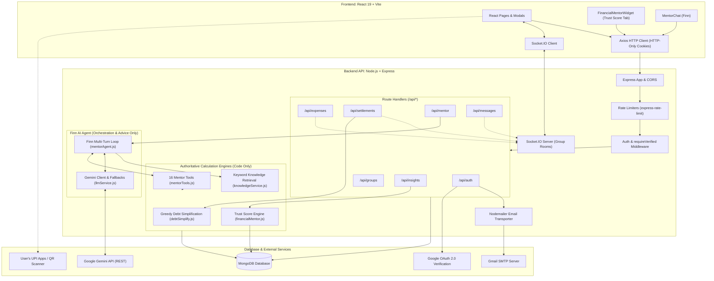

# Settl. 💸

> **Smart Expense Sharing, Peer-to-Peer Indian UPI Settlements & AI Financial Mentoring**

[](https://nodejs.org/)
[](https://react.dev/)
[](https://expressjs.com/)
[](https://www.mongodb.com/)
[](https://tailwindcss.com/)
[](https://vitejs.dev/)
[](LICENSE)

Settl is a modern full-stack bill-sharing and personal finance platform built for flatmates, friends, travel groups, and shared households. It solves the friction of tracking shared group costs, eliminates awkward manual payment reconciliation through **greedy debt simplification**, facilitates instant zero-fee repayments via **Indian UPI deep links and dynamic QR codes**, promotes healthy group accountability through an authoritative **Trust Score (0–100)**, and delivers personalized financial coaching via **Finn**, an AI Financial Mentor powered by Google Gemini.

---

## Table of Contents

- [Key Features](#key-features)
- [System Architecture](#system-architecture)
- [Trust Score Engine](#trust-score-engine)
- [Finn AI Financial Mentor](#finn-ai-financial-mentor)
- [Debt Simplification Algorithm](#debt-simplification-algorithm)
- [Real-Time WebSocket Events](#real-time-websocket-events)
- [Technology Stack](#technology-stack)
- [Repository Structure](#repository-structure)
- [Installation and Local Development](#installation-and-local-development)
- [Environment Variables](#environment-variables)
- [API Documentation](#api-documentation)
- [Data Models & Business Logic](#data-models--business-logic)
- [Testing and Quality Checks](#testing-and-quality-checks)
- [Security, Privacy, and Limitations](#security-privacy-and-limitations)
- [Deployment Configuration](#deployment-configuration)
- [Roadmap and Contributing](#roadmap-and-contributing)
- [Disclaimer and License](#disclaimer-and-license)

---

## Key Features

### 1. Authentication & Session Security
- **JWT in HTTP-Only Cookies**: Secure, cross-site scripted session management using HTTP-only cookies (`sameSite: 'lax'` in development, `sameSite: 'none'` and `secure: true` in production).
- **Email Verification**: Tokenized email confirmation links dispatched through Nodemailer with rate limiting and expiration guards.
- **Google OAuth 2.0**: Integrated Google Sign-In with backend token verification via `google-auth-library`.
- **Profile Management**: User profile customization including name, email, and UPI ID for instant peer payments.

### 2. Group Collaboration & Role Membership
- **Group Workspaces**: Create groups for trips, apartments, events, or shared households with configurable currencies.
- **Role-Based Membership**: Group creators are assigned `admin` roles; members collaborate seamlessly on shared expense ledgers.
- **Invite by Email**: Add registered users directly into groups via email lookups.

### 3. Multi-Strategy Expense Splitting
- **Equal Splits**: Split expenses evenly among all or selected group members.
- **Exact Rupee Splits**: Allocate custom exact rupee amounts with server-side sum validation matching the total bill.
- **Percentage Splits**: Split by percentages with server-side verification ensuring shares sum exactly to 100%.
- **Paise Precision**: All internal balance and split calculations use integer paise (`Math.round(amount * 100)`) to eliminate floating-point arithmetic rounding errors.

### 4. Greedy Debt Simplification
- **Graph Optimization**: Reduces complex multi-party webs of IOUs into the minimum possible number of direct peer-to-peer repayments.
- **Net Balance Partitioning**: Sorts members into creditors and debtors, greedily matching the largest debtor to the largest creditor until all obligations clear.
- **Direction & Limit Validation**: Prevents backwards settlements, overpayments beyond simplified debt limits, and duplicate in-flight requests.

### 5. Two-Sided Settlement Lifecycle & Verification
- **Payer Initiation**: Payer initiates a settlement request (`pending`), setting a default 7-day due date.
- **Receiver Confirmation**: Receiver verifies their bank account or UPI app and confirms payment (`confirmed`), which atomically updates balances.
- **Audit-Preserved Rejections**: If an unreceived payment is claimed, the receiver rejects it (`rejected`) with an explicit reason. The record is preserved in MongoDB for dispute auditing and penalizes trust scores.
- **Payer Cancellation**: Payers can cancel accidental or incorrect in-flight requests (`cancelled`) without penalty.
- **Auto-Expiry**: Stale pending requests older than 7 days automatically transition to `expired`.

### 6. Indian UPI Payment Facilitation
- **Mobile Deep Linking**: Instant `upi://pay` URI scheme launch opening installed UPI apps (Google Pay, PhonePe, Paytm, BHIM).
- **Dynamic Desktop QR Codes**: Automatically generates scan-and-pay dynamic QR codes using `qrcode.react`.
- **Visibility Detection**: Listens to browser `visibilitychange` events to detect when a user returns from their UPI app and automatically prompts settlement logging.
- **UPI ID Clipboard Copy**: One-click copy with verified format validation.

### 7. Real-Time Synchronization & Audit Logs
- **Socket.IO Room Partitioning**: Group members join isolated socket rooms (`groupId`) to receive instant live updates without polling.
- **Live Event Broadcasts**: Instant UI updates on `expense_added`, `expense_deleted`, `settlement_requested`, `settlement_done`, and `settlement_undone`.
- **Group Activity Feed**: Chronological, paged audit feed of all member additions, expenses, and settlement lifecycle transitions.
- **Group Chat**: In-app messaging inside group workspaces with real-time delivery (`message_created`).

### 8. Premium Dark Navy & Violet UI
- **Responsive Dashboard**: Dark navy (`#0b1222`) and violet dashboard aesthetic designed for mobile and desktop screens.
- **Financial Summaries**: At-a-glance cards showing total owed, total owed to you, net balance, and active groups.
- **Slide-Over & Modals**: Smooth slide-over panels for settlements, expense forms, and full-screen mobile drawers.

### 9. Finn — AI Personal Financial Mentor
- **Conversational Financial Education**: Multi-turn dialogue powered by Google Gemini with tool calling, strict debt-prioritization rules, and neutral educational tone.
- **16 Deterministic Tools**: Safe server-side handlers for Settl group balances, spending breakdowns, spending trends, and financial calculators.
- **Keyword-Grounded Regulatory Knowledge**: Retrieved passages from a verified bank of Indian financial facts (RBI, SEBI, AMFI, DICGC, Income Tax Dept) with source citations.
- **Consent-Gated Financial Profile**: Optional profile storing monthly income, savings targets, and financial goals, accessed strictly when user consent is granted.

### 10. Authoritative Trust Score Engine
- **Behavioral Scoring (0–100)**: Evaluates settlement follow-through, punctuality, upfront contributions, and dispute incidents.
- **Dedicated Trust Score Tab**: Interactive tab inside the mentor widget displaying score gauge, status badge, score trend, factor breakdown, pending commitments, score ledger, and milestone suggestions.

---

## System Architecture

The following diagram illustrates the real request flow and boundaries among client components, Express middleware, internal calculation engines, database models, and external services:



> **Critical Architectural Boundary**: The AI model (Gemini) **never** calculates or modifies the authoritative Trust Score, does not execute transactions, and does not perform unverified floating-point math. All scores, debt graphs, and loan calculations are executed deterministically by audited JavaScript engines in the backend.

---

## Trust Score Engine

The Settl Trust Score is a behavioral metric ranging from **0 to 100** that measures a member's reliability in settling debts and participating in shared expenses within Settl.

### What the Score Means (and Does Not Mean)
- **What it represents**: Peer repayment follow-through, promptness in initiating settlements when owing money, willingness to front shared costs, and absence of disputed payment claims within Settl groups.
- **What it does NOT represent**: It is **not** a credit score from a credit bureau (such as CIBIL, Experian, or Equifax), does not evaluate external creditworthiness, does not inspect personal bank account balances, and does not guarantee financial capacity.

### Eligibility Rules
A user does not receive a numerical score immediately upon signing up. To prevent unearned default scores (e.g. ranking a brand new user at 100 with zero track record), a user must meet two baseline thresholds:
1. **At least 3 involved expenses** (`splits.user === userId` or `paidBy === userId` with share > 0).
2. **Activity spanning at least 2 distinct calendar months**.

If a user has not met these thresholds, the backend returns `status: "new"` with `score: null` and `scoreBand: "New"`. The UI renders a transparent progress card showing exact remaining requirements (e.g., *1/3 expenses, 1/2 active months*).

### Scoring Dimensions and Current Weights

Once eligible, the score is calculated by `computeMentorReport()` in [`backend/src/utils/financialMentor.js`](backend/src/utils/financialMentor.js):

$$\text{Raw Score} = \sum_{d \in \text{Qualifying}} \left( \frac{W_d}{\sum W_q} \times S_d \right) - \text{Dispute Penalty}$$

| Dimension | Default Weight | Qualification Criteria | Description & Formula |
| :--- | :--- | :--- | :--- |
| **Repayment Reliability** | **50%** (`0.50`) | $\ge 2$ settlements initiated | Evaluates payment follow-through ($60\%$) and settlement initiative speed ($40\%$). |
| **Upfront Contribution** | **35%** (`0.35`) | $\ge 3$ involved expenses | Recency-weighted ratio of group expenses paid upfront by the user vs total involved expenses. |
| **Spending Consistency** | **15%** (`0.15`) | $\ge 3$ active calendar months | Month-to-month spending stability based on coefficient of variation ($1 - \frac{\sigma}{\mu}$), scaled by a confidence factor ($0.6\text{–}1.0$) for equal vs custom splits. |

#### 1. Follow-Through & Staleness Mechanics
Follow-through measures the proportion of initiated settlements that are confirmed by the receiver. Cancelled requests (`status: "cancelled"`) and rejected requests are excluded from the denominator so users are not penalized for correcting in-flight payment errors:
- **Recency Weights**: Transactions are weighted by age: $\le 30\text{ days} = 1.0$, $31\text{–}90\text{ days} = 0.5$, $>90\text{ days} = 0.2$.
- **Pending Staleness Credit Factor**:
  - Confirmed settlements: $1.0$ (100% credit).
  - Pending $< 3$ days: $1.0$ (grace period, neutral).
  - Pending $3\text{–}14$ days: Linear decay from $1.0$ down to $0.0$ ($1.0 - \frac{\text{age} - 3}{11}$).
  - Pending $> 14$ days: $0.0$ credit (full penalty until resolved).

#### 2. Settlement Initiative Speed
Measures the average elapsed time between an expense being added and the debtor initiating a settlement to repay it. The benchmark is 14 days (336 hours):
$$\text{Initiative Score} = \text{clamp}\left(100 - \frac{\text{Average Initiative Hours}}{336} \times 100,\; 0,\; 100\right)$$

#### 3. Dispute Deductions (`reliabilityIncidents`)
When a receiver rejects a claimed settlement (`POST /api/settlements/reject`), the incident is recorded in `ActivityLog`. An exponential diminishing-penalty deduction is applied directly against the composite score:
$$\text{Penalty Points} = \text{round}\left(50 \times \left(1 - e^{-0.4 \times R_{\text{weighted}}}\right)\right)$$
where $R_{\text{weighted}}$ is the recency-weighted count of rejected payment attempts. The deduction caps at 50 points.

### Score Bands
- **Excellent (80–100)**: Strong record of prompt repayments and consistent shared contributions.
- **Good (60–79)**: Dependable repayment history with minor delays or lower upfront contribution.
- **Needs Attention (40–59)**: Frequent settlement delays or pending settlements older than 7 days.
- **At Risk (0–39)**: Unresolved debts, high staleness, or receiver-disputed payment attempts.
- **New (null)**: Insufficient history to calculate a fair score.

### Explanation of the "Confirmed on Time" Metric
The observation text *“X% of your payments were confirmed on time”* displayed in the UI is calculated in [`backend/src/routes/insights.js`](backend/src/routes/insights.js) as:
$$\text{onTimePercent} = \text{round}\left(\frac{\text{Confirmed Settlements Count}}{\text{Total Settlements Initiated}} \times 100\right)$$
- **Denominator**: All settlements initiated by the user (`from: userId`) within the user's shared groups.
- **Numerator**: The subset of those settlements that have been confirmed by the receiving party (`status === "confirmed"`).
- **Important Distinction**: This metric represents **peer confirmation** within the Settl application (a peer verifying that they received funds). It is **not** an independently verified bank statement audit of wire transfer execution times.

### Score History & Idempotent Ledger
- **Model**: `ScoreHistory` records historical score snapshots with `score`, `delta`, `reason`, `eventId`, and `eventType`.
- **Idempotency**: Fetching `/api/insights/mentor` does **not** insert duplicate records. A new snapshot is written only if the numerical score has changed or if at least 7 days have elapsed since the prior weekly checkpoint.
- **Score Trend**: The API provides `scoreTrend` containing `delta`, `previousScore`, and `daysAgo`, displayed as a trend badge in the widget.

### Trust Score Tab Features
The Trust Score tab in [FinancialMentorWidget.jsx](frontend/src/components/FinancialMentorWidget.jsx) provides:
1. **Circular Gauge & Status Badge**: Displays prominent $X/100$ score with color-coded band (violet/emerald/amber/rose).
2. **Trend Pill**: Shows point change since the last valid update (e.g. `+4 pts`).
3. **Quick Action Prompts**: "Explain Score", "Settle Guide", and "Score Ledger" buttons that populate prompt queries into Finn chat.
4. **Sub-Tabs**:
   - **Factors**: Progress bars and weights for the 4 scoring factors.
   - **Commitments**: Active pending debts with counterparty, group, amount, genuine due dates, and overdue badges.
   - **History**: Audit ledger timeline of recent score events with points gained or lost.
5. **Next Milestone Checklist**: Practical action item to improve or maintain the score based on real data.

---

## Finn AI Financial Mentor

Finn is Settl's built-in conversational AI financial mentor. It combines multi-turn reasoning via Google Gemini with 16 deterministic backend tools and an authoritative regulatory knowledge base.

### Architecture & Agent Loop
1. **User Message & History**: The frontend dispatches user queries to `POST /api/mentor/chat`. The backend retrieves the last 10 conversation turns from `MentorConversation`.
2. **Knowledge Grounding**: `knowledgeService.js` performs tokenized keyword matching against a curated database of verified Indian finance facts (`financeFacts.json`). The top matching passages (with official regulatory URLs) are injected into the system prompt.
3. **Tool Calling Loop**: Gemini evaluates the query against declared tool schemas. When tool calls are generated, the server executes them with strict `userId` scoping, deduplicating identical calls via signature caching.
4. **Synthesis & Citation**: Gemini synthesizes the guidance, citing authoritative regulatory sources (RBI, SEBI, AMFI, DICGC) and outputting markdown with deterministic figures.

### Verified Tool Registry (16 Tools)

All 16 tools are defined in [`backend/src/services/mentorTools.js`](backend/src/services/mentorTools.js). Parameter names and required constraints match the implementation:

| Category | Tool Name | Parameters | Description |
| :--- | :--- | :--- | :--- |
| **Settl Data** | `getUserFinancialSummary` | None | Comprehensive overview of groups, upfront spend, total owed, total owed to user, net balance, and pending settlements. |
| **Settl Data** | `getGroupBalances` | None | Detailed balances across all user groups with member lists, simplified debts, and pending requests. |
| **Settl Data** | `getPendingSettlements` | None | Pending settlements requiring confirmation by the user or awaiting confirmation from others. |
| **Settl Data** | `getExpenseBreakdown` | `months` (optional): 1 to 12, default 3 | Categorical spending breakdown (food, rent, groceries, shopping, etc.) with amounts and percentage shares. |
| **Settl Data** | `getSpendingTrend` | `months` (optional): 1 to 12, default 6 | Monthly spending trends (up to 12 months) showing group share spending, upfront payments, and expense counts. |
| **Settl Data** | `getTrustScoreDetails` | None | Trust Score (0–100), score band, promptness hours, on-time rate, dispute count, and 4 dimension sub-scores. |
| **Settl Data** | `getTrustScoreHistory` | None | Historical Trust Score snapshots from `ScoreHistory` (up to 20 entries) with score and timestamp. |
| **Settl Data** | `getSettlementHistory` | `limit` (optional): 1 to 50, default 10 | Recent settlement history showing group, amount, status, direction (paid/received), counterpart, and date. |
| **Profile** | `getUserProfile` | None | User financial profile (status, income, savings target, risk comfort, language, active goals); requires consent. |
| **Profile** | `getGoalProgress` | `goalName` (optional): asks which goal if omitted and multiple exist | Goal progress metrics, remaining amount, months left, required monthly savings, and capacity gap; requires consent. |
| **Calculator** | `calculateSavingsTimeline` | `targetAmount` (required): > 0; `monthlyAmount` (required): > 0; `savedSoFar` (optional): >= 0, default 0 | Computes months and years needed to save target amount given monthly savings contribution. |
| **Calculator** | `calculateSIP` | `monthlyInvestment` (required): 1 to 10 Cr; `rateOfReturnAnnual` (optional): 0 to 30%, default 12%; `timePeriodYears` (optional): 1 to 40, default 5 | Computes SIP future returns, total invested, and estimated returns using monthly compounding in JS (marks assumed return rate when omitted). |
| **Calculator** | `calculateBudgetSplit` | `monthlyIncome` (optional): falls back to profile income | Computes rule-of-thumb monthly budget allocation (50% Needs, 30% Wants, 20% Savings) in JS. |
| **Calculator** | `calculateEmergencyFund` | `customMonthlyExpenses` (optional): falls back to profile or group data; `monthsCount` (optional): 1 to 24, default 6 (3 for students/interns) | Computes recommended emergency reserve pool based on monthly expense baseline and target coverage. |
| **Calculator** | `calculateLoanEMI` | `principal` (required): > 0; `annualInterestRate` (required): >= 0%; `tenureMonths` (required): 1 to 360 | Computes monthly EMI, total interest, and total payment for a loan using deterministic amortization formulas in JS. |
| **Calculator** | `calculateCompoundInterest` | `principal` (required): > 0; `annualInterestRate` (required): >= 0%; `timePeriodYears` (required): 1 to 50; `compoundingFrequencyPerYear` (optional): default 1 | Computes future value of a lump-sum deposit or investment under compound interest in JS. |

### Strict Behavioral Guardrails
- **Debt Prioritization**: If the user owes unsettled group debts or has an "At Risk" Trust Score, Finn prioritizes debt clearance and refuses to recommend aggressive investing or discretionary purchases.
- **Affordability Boundaries**: Explicitly states that Settl cannot see private bank balances. Never provides blanket "approval" for luxury purchases.
- **No LLM Arithmetic**: All mathematical computations, percentages, EMI values, and SIP returns are calculated by deterministic JavaScript functions; Gemini is forbidden from inventing mathematical figures.
- **Data Consent Enforcement**: Private Settl financial data tools (`PRIVATE_SETTL_TOOLS`) and profile tools refuse execution if the user has not enabled `consentToUseForMentor` in their profile.
- **Input Sanitization**: User-controlled inputs are sanitized via `sanitizePromptText()` to strip delimiter injection attempts before reaching the model.

---

## Debt Simplification Algorithm

The debt simplification engine ([`backend/src/utils/debtSimplify.js`](backend/src/utils/debtSimplify.js)) resolves arbitrary group expense splits into the theoretical minimum number of transactions using a greedy bipartite matching algorithm:

1. **Paise-Integer Balance Mapping**: Computes net balances in integer paise. Each expense credits the payer for the full amount and debits each split member for their exact share.
2. **Confirmed Settlement Offsets**: Only settlements with `status: "confirmed"` reduce outstanding balances.
3. **Partitioning**: Members are partitioned into Creditors ($\text{balance} > 0$) and Debtors ($\text{balance} < 0$).
4. **Deterministic Sorting**: Creditors and Debtors are sorted descending by absolute balance magnitude, using `userId` string comparison as a tie-breaker.
5. **Greedy Matching Loop**: The largest debtor pays the largest creditor $\min(\text{debtorAmount}, \text{creditorAmount})$. The settled amount is subtracted from both balances, and pointers advance until all net balances reach zero.

---

## Real-Time WebSocket Events

Settl uses Socket.IO to keep connected clients synchronized. Clients join rooms partitioned by `groupId`:

| Event Name | Direction | Payload | Description |
| :--- | :--- | :--- | :--- |
| `join_group` | Client → Server | `groupId` | Joins the specified group room after verifying user membership. |
| `leave_group` | Client → Server | `groupId` | Leaves the group room. |
| `expense_added` | Server → Client | Populated `Expense` | Emitted when an expense is added; updates list and recalculates balances. |
| `expense_deleted` | Server → Client | `{ expenseId }` | Emitted when an expense is deleted; removes item from view. |
| `settlement_requested` | Server → Client | Populated `Settlement` | Notifies the receiver that a payment was marked as sent. |
| `settlement_done` | Server → Client | Populated `Settlement` | Notifies the group that the receiver confirmed receipt. |
| `settlement_undone` | Server → Client | `{ fromId, toId }` | Emitted when a settlement is cancelled by payer or rejected by receiver. |
| `message_created` | Server → Client | Populated `Message` | Broadcasts new group chat messages. |

---

## Technology Stack

### Frontend
| Package | Version | Purpose |
| :--- | :--- | :--- |
| `react` / `react-dom` | `^19.2.6` | Modern UI component rendering |
| `vite` | `^8.0.12` | High-speed frontend build tool and dev server |
| `react-router-dom` | `^7.15.1` | Client-side routing and protected route wrappers |
| `tailwindcss` / `@tailwindcss/vite` | `^4.3.0` | Utility-first CSS styling framework |
| `axios` | `^1.16.1` | HTTP client with cookie interceptors |
| `socket.io-client` | `^4.8.3` | Real-time WebSocket connection to group rooms |
| `qrcode.react` | `^4.2.0` | SVG QR code generator for desktop UPI payments |
| `react-markdown` / `remark-gfm` | `^10.1.0` / `^4.0.1` | Markdown and table rendering in Finn chat |

### Backend
| Package | Version | Purpose |
| :--- | :--- | :--- |
| `node` | `>=18.0.0` (ESM) | JavaScript runtime environment |
| `express` | `^4.19.2` | REST API routing and middleware framework |
| `mongoose` | `^8.3.1` | MongoDB Object Data Modeling (ODM) |
| `socket.io` | `^4.7.5` | Real-time bi-directional WebSocket server |
| `jsonwebtoken` | `^9.0.2` | Cryptographic signing for session tokens |
| `cookie-parser` | `^1.4.7` | HTTP-only cookie parsing middleware |
| `bcryptjs` | `^2.4.3` | Salted password hashing |
| `express-rate-limit` | `^8.2.1` | IP and user rate limiting on sensitive routes |
| `google-auth-library` | `^10.6.2` | Verification of Google OAuth 2.0 ID tokens |
| `nodemailer` | `^9.0.3` | SMTP email dispatch for account verification |
| `dotenv` | `^16.4.5` | Environment variable management |

---

## Repository Structure

```text
Settl/
├── backend/
│   ├── src/
│   │   ├── config/
│   │   │   └── db.js                 # MongoDB connection using Mongoose
│   │   ├── constants/
│   │   │   └── mentor.js             # Finn mentor constants and names
│   │   ├── data/
│   │   │   └── financeFacts.json     # Curated Indian finance facts with regulatory sources
│   │   ├── middleware/
│   │   │   ├── auth.js               # JWT verification & HTTP-only cookie extraction
│   │   │   └── requireVerified.js    # Guard requiring isEmailVerified === true
│   │   ├── models/
│   │   │   ├── ActivityLog.js        # Audit trail for group events & rejections
│   │   │   ├── Expense.js            # Shared expenses with equal/exact/percentage splits
│   │   │   ├── Group.js              # Expense groups, members, and roles
│   │   │   ├── MentorConversation.js # Multi-turn Finn chat message history
│   │   │   ├── Message.js            # Group chat messages
│   │   │   ├── ScoreHistory.js       # Idempotent Trust Score snapshots & deltas
│   │   │   ├── Settlement.js         # Peer-to-peer settlements (pending/confirmed/rejected/cancelled)
│   │   │   ├── User.js               # User accounts, credentials, and UPI IDs
│   │   │   └── UserFinancialProfile.js # Consent-gated profile (income, targets, goals)
│   │   ├── routes/
│   │   │   ├── auth.js               # Login, register, verify-email, Google OAuth
│   │   │   ├── expenses.js           # Expense CRUD and group expense feeds
│   │   │   ├── groups.js             # Group management and member invitation
│   │   │   ├── insights.js           # Trust score, mentor overview, whyFacts, tips
│   │   │   ├── mentor.js             # Finn chat endpoint, streaming, profile CRUD
│   │   │   ├── messages.js           # Group chat message history
│   │   │   └── settlements.js        # Debt simplification, settle, confirm, reject, cancel
│   │   ├── services/
│   │   │   ├── knowledgeService.js   # Keyword search and citation formatter for facts
│   │   │   ├── llmService.js         # Gemini API client with fallback models & retries
│   │   │   ├── mentorAgent.js        # Finn agent loop, system prompt, tool execution
│   │   │   └── mentorTools.js        # Registry of 16 deterministic Finn tools
│   │   ├── utils/
│   │   │   ├── debtSimplify.js       # Greedy debt simplification algorithm
│   │   │   ├── email.js              # Nodemailer email verification dispatch
│   │   │   ├── financialMentor.js    # Authoritative Trust Score calculation engine
│   │   │   └── sanitizeInput.js      # Input sanitization against prompt injection
│   │   ├── app.js                    # Express application configuration & route mounting
│   │   └── socket.js                 # Socket.IO initialization & authenticated connection handling
│   ├── test/
│   │   ├── docsInSync.test.mjs       # Verifies README tool table matches mentorTools.js
│   │   ├── mentor12Scenarios.test.mjs # 12 end-to-end Finn scenario tests
│   │   ├── mentorPersonalization.test.mjs # Multi-turn personalization tests
│   │   ├── mentorRoutes.test.mjs     # Supertest route tests for /api/mentor
│   │   ├── mentorToolsSlice1.test.mjs # Unit tests for 16 Finn tools & calculators
│   │   ├── settlementsRoutes.test.mjs # Settlement lifecycle integration test suite
│   │   ├── settlementsValidation.test.mjs # Settlement edge & validation tests
│   │   ├── testDbHelper.mjs          # Isolated test database connection guard
│   │   └── trustScore2.test.mjs      # Trust score eligibility, rejection, & idempotency tests
│   ├── package.json                  # Backend dependencies & test scripts
│   └── server.js                     # HTTP server entry point
├── frontend/
│   ├── src/
│   │   ├── api/
│   │   │   ├── axios.js              # Axios instance configured with withCredentials
│   │   │   └── mentor.js             # Client API bindings for Finn chat & profile
│   │   ├── components/
│   │   │   ├── ConfirmPaymentPopup.jsx # Modal confirming settlement receipt
│   │   │   ├── FinancialMentorWidget.jsx # Trust score tab & Finn chat container
│   │   │   ├── MentorChat.jsx        # Finn chat interface with markdown rendering
│   │   │   ├── Navbar.jsx            # Top navigation bar
│   │   │   └── UPIPaymentModal.jsx   # UPI QR code & mobile deep link modal
│   │   ├── context/
│   │   │   ├── AuthContext.jsx       # Global user authentication state
│   │   │   └── NotificationContext.jsx # Toast notifications and live alerts
│   │   ├── pages/
│   │   │   ├── Dashboard.jsx         # User dashboard with balances & groups
│   │   │   ├── GroupDetail.jsx       # Group expense ledger, debts, chat, & activity
│   │   │   ├── Landing.jsx           # Public landing page
│   │   │   ├── Login.jsx             # User login page
│   │   │   ├── Profile.jsx           # User profile & UPI configuration
│   │   │   ├── Register.jsx          # New user registration
│   │   │   ├── SettleUp.jsx          # Settlement dashboard & transaction actions
│   │   │   └── VerifyEmail.jsx       # Email verification callback handler
│   │   ├── App.jsx                   # React Router route configuration
│   │   ├── index.css                 # Global CSS and Tailwind directives
│   │   └── main.jsx                  # React application mount
│   ├── package.json                  # Frontend dependencies & build scripts
│   ├── vercel.json                   # Vercel SPA rewrite configuration
│   └── vite.config.js                # Vite build and plugin setup
├── LICENSE                           # MIT License
└── README.md                         # Project documentation
```

---

## Installation and Local Development

### Prerequisites
- **Node.js**: `v18.0.0` or higher
- **npm**: `v9.0.0` or higher
- **MongoDB**: Local MongoDB daemon (`mongodb://localhost:27017`) or a MongoDB Atlas connection string
- **Google AI Studio API Key**: Optional for base app, required for Finn AI and AI tips

### 1. Clone the Repository
```bash
git clone https://github.com/mikumaraditya/settl.git
cd settl
```

### 2. Install Dependencies
```bash
# Install backend dependencies
cd backend
npm install

# Install frontend dependencies
cd ../frontend
npm install
cd ..
```

### 3. Configure Environment Variables
Create `.env` files in both `backend/` and `frontend/` directories from the provided examples:

```bash
# In backend/
cp backend/.env.example backend/.env

# In frontend/
cp frontend/.env.example frontend/.env
```

*(See [Environment Variables](#environment-variables) for configuration details).*

### 4. Start Development Servers

Open two terminal windows:

**Terminal 1 — Backend Server** (starts on `http://localhost:5000`):
```bash
cd backend
npm run dev
```

**Terminal 2 — Frontend Client** (starts on `http://localhost:5173`):
```bash
cd frontend
npm run dev
```

### 5. Access the Application
- **Frontend Web Application**: [http://localhost:5173](http://localhost:5173)
- **Backend Health Check**: [http://localhost:5000/health](http://localhost:5000/health)
- **AI Mentor Health Check**: [http://localhost:5000/api/mentor/health](http://localhost:5000/api/mentor/health)

---

## Environment Variables

### Backend Configuration (`backend/.env`)

| Variable Name | Required | Description | Example Placeholder |
| :--- | :--- | :--- | :--- |
| `PORT` | Optional | Port for the Express server (default: `5000`) | `5000` |
| `HOST` | Optional | Network interface binding (default: `0.0.0.0`) | `0.0.0.0` |
| `NODE_ENV` | Optional | Environment mode (`development`, `production`, `test`) | `development` |
| `MONGO_URI` | **Required** | MongoDB connection URI for application data | `mongodb://localhost:27017/settl` |
| `MONGO_URI_TEST` | Optional | Isolated test database URI (must end with `_test`) | `mongodb://localhost:27017/settl_test` |
| `JWT_SECRET` | **Required** | Secret key for signing session JWTs | `your_long_random_jwt_secret_key` |
| `FRONTEND_URL` | **Required** | Allowed origin for CORS and email verification links | `http://localhost:5173` |
| `GEMINI_API_KEY` | Optional | Google AI Studio API key for Finn AI mentor | `your_google_gemini_api_key` |
| `GEMINI_MODEL` | Optional | Primary Gemini model ID (default: `gemini-3.1-flash-lite`) | `gemini-3.1-flash-lite` |
| `GEMINI_MODEL_LITE`| Optional | Fallback model ID for tips (default: `gemini-3.1-flash-lite`) | `gemini-3.1-flash-lite` |
| `GEMINI_THINKING_LEVEL` | Optional | Reasoning budget level (`minimal`, `low`, `medium`, `high`) | `minimal` |
| `GEMINI_THINKING_BUDGET`| Optional | Token budget for reasoning models | `1024` |
| `GOOGLE_CLIENT_ID`| Optional | Google OAuth Client ID for verifying Google Sign-In | `your_google_client_id.apps.googleusercontent.com` |
| `GMAIL_USER` | Optional | Gmail address for Nodemailer verification emails | `your_email@gmail.com` |
| `GMAIL_APP_PASSWORD` | Optional | 16-character Google App Password for SMTP | `your_app_password` |

> **Security Rule**: `GEMINI_API_KEY` must **never** be exposed in the frontend or prefixed with `VITE_`. All mentor interactions are proxied through authenticated backend routes.

### Frontend Configuration (`frontend/.env`)

| Variable Name | Required | Description | Example Placeholder |
| :--- | :--- | :--- | :--- |
| `VITE_API_URL` | Optional | Base URL of the backend API (default: `http://localhost:5000`) | `http://localhost:5000` |
| `VITE_GOOGLE_CLIENT_ID` | Optional | Google OAuth Client ID for rendering Google Sign-In button | `your_google_client_id.apps.googleusercontent.com` |

---

## API Documentation

All application endpoints are mounted under `/api` and require authenticated HTTP-only cookie sessions unless designated as Public:

### Authentication (`/api/auth`)
| Method | Endpoint | Access | Description |
| :--- | :--- | :--- | :--- |
| `POST` | `/api/auth/register` | Public | Register a new user account (rate limited: 5/hr). |
| `POST` | `/api/auth/login` | Public | Authenticate password; sets HTTP-only session cookie (rate limited: 10/15m). |
| `POST` | `/api/auth/google` | Public | Authenticate via Google OAuth token. |
| `GET` | `/api/auth/verify-email` | Public | Verify user email address token. |
| `POST` | `/api/auth/resend-verification` | Public | Resend email verification link (rate limited: 3/hr). |
| `POST` | `/api/auth/logout` | Public | Clears the session cookie. |
| `GET` | `/api/auth/me` | Protected | Fetch currently authenticated user session. |
| `PUT` | `/api/auth/profile` | Protected | Update user profile details and UPI ID. |

### Groups (`/api/groups`)
| Method | Endpoint | Access | Description |
| :--- | :--- | :--- | :--- |
| `POST` | `/api/groups` | Protected | Create a new expense group. |
| `GET` | `/api/groups` | Protected | List all groups the current user is a member of. |
| `GET` | `/api/groups/:id` | Protected | Retrieve group details, member balances, and simplified debts. |
| `POST` | `/api/groups/:id/members` | Protected | Add a registered user to the group by email address. |

### Expenses (`/api/expenses`)
| Method | Endpoint | Access | Description |
| :--- | :--- | :--- | :--- |
| `POST` | `/api/expenses` | Protected | Create a new shared expense with equal, exact, or percentage splits. |
| `GET` | `/api/expenses/group/:id` | Protected | Fetch paginated group expenses filtered by month. |
| `DELETE`| `/api/expenses/:id` | Protected | Delete an expense (restricted to payer or group admin). |

### Settlements (`/api/settlements`)
| Method | Endpoint | Access | Description |
| :--- | :--- | :--- | :--- |
| `GET` | `/api/settlements/simplify/:id` | Protected | Compute net balances and simplified debt transactions for a group. |
| `POST` | `/api/settlements/settle` | Protected | Payer requests a settlement (`pending`), setting a 7-day default due date. |
| `POST` | `/api/settlements/confirm` | Protected | Receiver confirms payment receipt (`confirmed`), clearing the debt. |
| `POST` | `/api/settlements/reject` | Protected | Receiver rejects unreceived payment (`rejected`), recording the reason. |
| `DELETE`| `/api/settlements/settle` | Protected | Payer cancels their pending settlement request (`cancelled`). |
| `POST` | `/api/settlements/cancel` | Protected | Alternate endpoint for payer cancellation. |
| `GET` | `/api/settlements/group/:id/activity` | Protected | Fetch paginated activity audit logs for a group. |

### Insights & Trust Score (`/api/insights`)
| Method | Endpoint | Access | Description |
| :--- | :--- | :--- | :--- |
| `GET` | `/api/insights/trust-score/:userId` | Protected | Compute authoritative Trust Score (0–100) for a group member. |
| `GET` | `/api/insights/mentor` | Protected | Full mentor report: score, trend, factor breakdown, pending commitments, history. |
| `GET` | `/api/insights/tips` | Protected | AI-generated financial tips based on group spending patterns. |

### Finn AI Financial Mentor (`/api/mentor`)
| Method | Endpoint | Access | Description |
| :--- | :--- | :--- | :--- |
| `GET` | `/api/mentor/health` | Public | Check Gemini API key configuration status. |
| `POST` | `/api/mentor/chat` | Protected | Send message to Finn agent; returns guidance and tool metadata. |
| `POST` | `/api/mentor/chat/stream` | Protected | Stream Finn responses via Server-Sent Events (SSE). |
| `GET` | `/api/mentor/history` | Protected | Retrieve stored multi-turn conversation history. |
| `DELETE`| `/api/mentor/history` | Protected | Clear stored conversation history. |
| `GET` | `/api/mentor/profile` | Protected | Retrieve financial profile and data-mentoring consent status. |
| `PUT` | `/api/mentor/profile` | Protected | Save financial profile (income, targets, goals, consent flag). |
| `DELETE`| `/api/mentor/profile` | Protected | Permanently delete financial profile and goals. |

### Messages & Chat (`/api/messages`)
| Method | Endpoint | Access | Description |
| :--- | :--- | :--- | :--- |
| `POST` | `/api/messages` | Protected | Post a chat message to a group room. |
| `GET` | `/api/messages/group/:id` | Protected | Fetch paginated chat history for a group. |

---

## Data Models & Business Logic

### Mongoose Schemas

```text
User ────< Group (members.user)
  │          │
  │          ├────< Expense (paidBy, splits.user)
  │          │
  │          ├────< Settlement (from, to)
  │          │
  │          ├────< ActivityLog (actor, meta)
  │          │
  │          └────< Message (sender)
  │
  ├────< ScoreHistory (user, score, delta, reason)
  ├────< MentorConversation (user, messages)
  └────< UserFinancialProfile (user, goals, consent)
```

1. **`User`**: Account record with hashed `password`, `upiId`, and email verification flags (`isEmailVerified`, `emailVerificationToken`, `emailVerificationExpires`).
2. **`Group`**: Shared workspace with `name`, `currency`, and an array of `members` storing `user` reference, `role` (`admin` or `member`), and `joinedAt`.
3. **`Expense`**: Shared cost containing `amount`, `category`, `paidBy`, and `splits` array (`user`, `amount`, `paid`). `splitType` is constrained to `equal`, `exact`, or `percentage`.
4. **`Settlement`**: Peer transaction between `from` and `to` members. `status` lifecycle transitions through `pending`, `confirmed`, `cancelled`, `expired`, and `rejected`. Stores `dueDate` and `rejectionReason`.
5. **`ActivityLog`**: Immutable audit record tracking `type` (`member_added`, `expense_created`, `expense_deleted`, `settlement_requested`, `settlement_confirmed`, `settlement_rejected`, `settlement_cancelled`) with metadata.
6. **`ScoreHistory`**: Historical ledger of Trust Scores containing `score`, `delta`, `reason`, `eventId`, and `eventType` (`initial_baseline`, `score_adjustment`, `weekly_snapshot`).
7. **`UserFinancialProfile`**: Consent-gated profile storing `status`, `monthlyIncome`, `monthlySavingsTarget`, `goals` (`name`, `targetAmount`, `deadline`, `savedSoFar`), `riskComfort`, and `consentToUseForMentor`.
8. **`MentorConversation`**: Chat turns between `user` and `model`, recording `content`, `toolsUsed`, and timestamps.
9. **`Message`**: Real-time group chat message with `group`, `sender`, and `content`.

---

## Testing and Quality Checks

The repository contains automated unit, integration, and scenario tests with strict test database safety guards:

### Test Commands

Run from the root or `backend/` directory:

```bash
# Run backend check (ESLint + full deterministic test suite)
npm --prefix backend run check

# Run individual backend suites:
node --test backend/test/mentorRoutes.test.mjs          # Supertest mentor routes
node backend/test/mentorToolsSlice1.test.mjs            # 16 Finn tools & calculators
node backend/test/settlementsRoutes.test.mjs            # 10 settlement lifecycle scenarios
node backend/test/settlementsValidation.test.mjs        # 4 debt validation edge cases
node backend/test/docsInSync.test.mjs                   # Verifies README matches tool registry
node backend/test/trustScore2.test.mjs                  # Trust Score 2.0 verification suite
node backend/test/mentor12Scenarios.test.mjs            # 12 end-to-end Finn scenario tests

# Run live Gemini personalization test (requires network & GEMINI_API_KEY)
npm --prefix backend run test:live

# Frontend build & lint checks
npm --prefix frontend run check
```

### Verified Test Results

All test suites have been executed against isolated test environments with **100% passing results**:
- **`trustScore2.test.mjs`**: Passed all 4 test suites (new user eligibility, cancelled settlement exclusion, rejected settlement preservation, and `ScoreHistory` idempotency).
- **`settlementsRoutes.test.mjs`**: Passed all 10 settlement lifecycle scenarios (direction validation, debt limits, auto-expiry, cancels, and confirmations).
- **`settlementsValidation.test.mjs`**: Passed all 4 validation checks.
- **`mentorToolsSlice1.test.mjs`**: Passed all 16 tool handler unit tests.
- **`mentor12Scenarios.test.mjs`**: Passed all 12 multi-scenario tests (57/57 assertions passing).
- **`docsInSync.test.mjs`**: Verified that all 16 tools and parameters in `README.md` match `MENTOR_TOOLS_REGISTRY` exactly.
- **ESLint & Vite Build**: `0` backend lint errors; frontend compiles production bundle cleanly with Vite.

### Test Database Safety Guard
To guarantee tests never mutate development or production databases, [`backend/test/testDbHelper.mjs`](backend/test/testDbHelper.mjs) enforces that `MONGO_URI_TEST` must point to a database name ending with `_test`:

```javascript
const parsedTest = new URL(testUri);
const testDbName = parsedTest.pathname.replace(/^\//, "");
if (!testDbName || !testDbName.endsWith("_test")) {
  throw new Error("SAFETY CHECK FAILED: Test database name must end with '_test'");
}
```

---

## Security, Privacy, and Limitations

### Security Protections Implemented
- **XSS-Resistant Cookies**: JWT tokens are stored exclusively in HTTP-only cookies; browser JavaScript cannot read session tokens.
- **Strict Server Scoping**: All database queries executed by REST routes and Finn tools enforce the authenticated `userId`. A user cannot view expenses or balances for groups they have not joined.
- **Paise Precision**: Avoids JavaScript floating-point rounding bugs by storing and computing all splits and balances as integer paise.
- **Data Consent Protection**: Private financial data and profiles are inaccessible to Finn unless the user explicitly enables `consentToUseForMentor`.
- **Prompt Sanitization**: User-provided strings (group names, goal names) are stripped of prompt injection patterns via `sanitizePromptText()`.
- **No Chat Logging**: Server logs do not print conversation text or prompt bodies.

### Current Limitations
- **In-Memory Rate Limiting**: `express-rate-limit` uses in-memory tracking which resets upon server restart. Multi-instance production clusters will require Redis.
- **Manual UPI Reconciliation**: Settlements depend on receiver peer confirmation. Settl does not connect to banking APIs to independently verify bank ledger entries.
- **Single Active Conversation**: Finn maintains one active conversation thread per user.

---

## Deployment Configuration

### Production Build
```bash
# Compile frontend production bundle
cd frontend
npm run build

# Start backend in production
cd ../backend
NODE_ENV=production npm start
```

### Frontend Single Page Application (SPA) Routing
For deployments on Vercel or similar platforms, [`frontend/vercel.json`](frontend/vercel.json) configures URL rewrites to prevent 404s on deep links:
```json
{
  "rewrites": [
    {
      "source": "/(.*)",
      "destination": "/index.html"
    }
  ]
}
```

### Production Security Checklist
- Set `NODE_ENV=production` in `backend/.env`.
- Ensure `FRONTEND_URL` points to your production HTTPS domain to enforce secure CORS and secure cookie attributes (`secure: true`, `sameSite: 'none'`).
- Whitelist server IP addresses in MongoDB Atlas Network Access.

---

## Roadmap and Contributing

### Implemented vs Planned Work

| Feature | Status | Notes |
| :--- | :--- | :--- |
| **Greedy Debt Simplification** | **Implemented** | Paise precision, bipartite matching, direction enforcement. |
| **UPI Deep Linking & Dynamic QR** | **Implemented** | `upi://pay` deep links and desktop SVG QR codes. |
| **Authoritative Trust Score (0–100)** | **Implemented** | 4-dimension scoring, staleness decay, dispute penalties, score ledger. |
| **Finn AI Financial Mentor** | **Implemented** | 16 tools, Gemini loop, keyword knowledge grounding, consent gating. |
| **Trust Score Interactive UI** | **Implemented** | Score gauge, trend pill, quick actions, factors, commitments, ledger. |
| **Redis-Backed Rate Limiting** | Planned | Distributed rate limiting across multiple server instances. |
| **Multi-Session Mentor Conversations** | Planned | Ability to save, name, and archive separate conversation threads. |
| **Settlement Due Date Customization** | Planned | Allowing payers and creditors to agree on custom settlement dates. |

### Contributing
1. Fork the repository and create a feature branch (`git checkout -b feature/amazing-feature`).
2. Run validation checks before committing (`npm --prefix backend run check` and `npm --prefix frontend run check`).
3. Commit your changes (`git commit -m 'Add amazing feature'`).
4. Push to your branch (`git push origin feature/amazing-feature`) and open a Pull Request.

---

## Disclaimer and License

### Personal Financial Guidance Disclaimer
Settl and Finn provide educational personal finance coaching and expense tracking only. Neither Settl nor Finn is a SEBI-registered investment adviser or certified financial planner. Guidance provided through the application does not constitute professional investment, tax, or legal advice.

### License
This project is licensed under the [MIT License](LICENSE).
